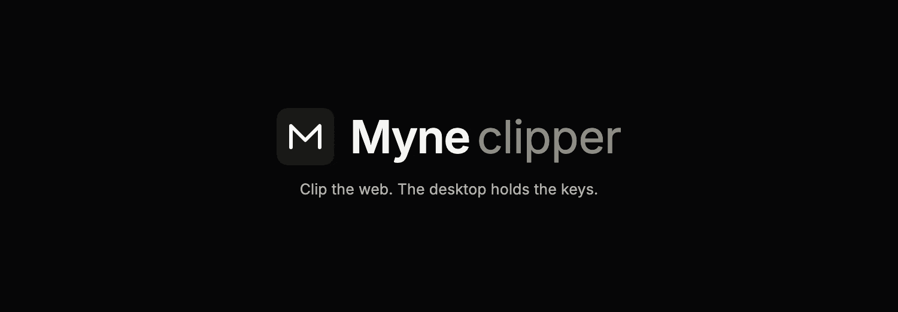

<p align="center"></p>

# Myne clipper

> Clip the web. The desktop holds the keys.

The Myne browser extension — a **keyless** web clipper. It captures the page you are reading and hands it to the running [Myne desktop app](https://github.com/myne-md/myne), which is the sole crypto site. This is one repo in the multi-repo [Myne](https://github.com/myne-md/myne) project; the protocol, threat model, and glossary it builds against live in the main repo's [`docs/`](https://github.com/myne-md/myne/tree/develop/docs).

It is **keyless by design**: the extension never receives the vault master key (`root_key`) or any per-note key (`item_key`), holds no plaintext queue, and is structurally incapable of decrypting anything in the vault. A captured clip is handed to the *already-unlocked* desktop core over a native-messaging channel (trust boundary **TB10**), which does all encryption via its existing pipeline. Even a fully compromised extension build (adversary **A14**) cannot read, modify, or delete notes. The browser is a proven-hostile runtime — silent web-store auto-update plus an adversary-controlled page DOM — so there is **zero crypto in this repo** and the `protocol/` crate is never linked here.

The extension targets **Chrome, Edge, and Firefox** as a single Manifest V3 codebase, reconciling the Chromium service-worker background and the Firefox event-page background through [`webextension-polyfill`](https://github.com/mozilla/webextension-polyfill). **Safari is out of v1 scope** — it cannot use the `nativeMessaging` host channel, and the localhost-bridge fallback it would need is deferred.

## Status

**Pre-alpha**, alongside the rest of Myne. Within that, the v1 extension is functionally complete and loadable, but unpublished — no store listing, no signed release, and the placeholder icons still await the design pass.

What exists in this repo today:

- A single cross-browser MV3 `manifest.json` + bundled background (Chromium service worker / Firefox event page).
- The native-messaging clip handoff (envelope + transport): `src/background/{clip,envelope,host-name}.ts`.
- The two-phase pairing handshake that mints a scoped, revocable token: `src/background/{pair,pair-wire,pair-adapter,pairing-token,durable-token}.ts`.
- The `is-unlocked-status` pre-check + throttled poller: `src/background/{status,status-wire,status-poller}.ts`.
- The in-page DOM→markdown capture, hand-rolled and zero-dependency: `src/content/capture.ts`.
- The URL bookmark path: `src/background/{bookmark,bookmark-adapter}.ts`.
- The toolbar / context-menu / keyboard-command triggers and the in-page toast + prompt content UI: `src/{background/toolbar.ts,content/}`.
- Vitest unit suites under `tests/`.

What is **not** here yet:

- A published / signed store build. The extension is built from source and loaded unpacked; there is no store listing, no published binary, and no release artifact. The manifest's dev `key` and both extension IDs are kept unchanged, because changing either forces a re-pair of every clipper.
- Runnable E2E. `e2e/clip-time-ux.scenarios.md` is **authored, not yet runnable** — it waits on the cross-process tauri-driver native-messaging harness, which lives desktop-side. The surface contract those scenarios depend on is pinned today by `tests/notice-contract.test.ts`.
- Branded icons (`src/icons/` ships placeholder marks).

## How it works

A clip never waits in the browser. There is **no plaintext queue** — nothing is written to browser storage to be ingested later. When the desktop is locked or closed, the extension captures nothing and prompts the user to unlock or open Myne. When the desktop is unlocked:

1. A user gesture (toolbar click or context-menu entry) triggers capture via `activeTab` — there is **no `<all_urls>` host permission and no auto-injected content scripts**. (The user-assignable keyboard commands drive the bookmark and pairing paths, not capture.)
2. The content script walks the page DOM into markdown in-process (`src/content/capture.ts`); no markdown/dialect/crypto library is shipped to the browser.
3. The background wraps the result in a native-messaging envelope and hands it to the unlocked desktop core over TB10. The desktop does all AEAD.
4. Clips save to the vault root. **No vault structure crosses into the browser** — there is no folder or tag picker, so the folder hierarchy and tag list never transit the hostile runtime.

The pairing handshake mints a **scoped, revocable token — not a key** — bound to the exact extension ID. Its scope ceiling is `create-clip` + `is-unlocked-status` only: never CRUD, never delete, never list. Even fully compromised, that token cannot read the vault.

### Cross-browser MV3 strategy

A **single `manifest.json`** carries **both** background keys: `background.service_worker` (Chromium reads it, Firefox ignores it) and `background.scripts` (Firefox event page reads it, Chromium ignores it), both pointing at the same bundled `background.js`. esbuild emits that bundle as a **classic IIFE script** (not ESM) so it loads identically under both runtimes. `webextension-polyfill` reconciles `chrome.*` (callback) vs `browser.*` (promise), so one source compiles for all three targets.

Permissions are deliberately minimal — `nativeMessaging`, `activeTab`, `scripting`, `contextMenus`, `storage` — with **no `host_permissions`**. A broad host match would trigger the "read all your data on every site" install warning and a slow store review, and it is not needed for user-gesture capture via `activeTab`. `storage` holds **only** the scoped pairing token, never a captured-clip buffer.

## Structure

```
myne-clipper/
├── src/
│   ├── manifest.json   ← MV3 manifest (both background keys; copied to dist/ by the build)
│   ├── background/     ← MV3 background: clip handoff, pairing, status, bookmark, toolbar
│   ├── content/        ← content script (runs in the adversary-controlled page DOM) + toast/prompt UI
│   ├── popup/          ← pairing / locked / closed affordances (index.ts + index.html + popup.css)
│   ├── lib/            ← shared models, icon state, design tokens, load-bearing copy
│   └── icons/          ← placeholder PNG marks + per-state SVGs (branded marks land with the design pass)
├── tests/              ← Vitest unit suites
├── e2e/                ← authored E2E scenarios (harness-gated; not yet runnable)
├── types/              ← local ambient .d.ts (e.g. webextension-polyfill → global browser)
├── scripts/build.mjs   ← esbuild bundler (one bundle step per entry; no dev server) → dist/
├── package.json        ← pinned, minimal deps (pnpm)
├── pnpm-lock.yaml       ← this repo's OWN lockfile (separate supply-chain surface)
└── tsconfig.json
```

This repo has its **own** supply chain, deliberately isolated from the desktop's. Its `pnpm-lock.yaml` must never contaminate the main repo's single shared `Cargo.lock`; the extension is not a Cargo workspace member and nothing here is a Rust crate. Its risk surface is the browser web-store auto-update chain (A14), distinct from the desktop's transitive-dependency surface (A8). "Adding a dependency is a security decision" applies here harder than anywhere — the only runtime dependency bundled into the extension is `webextension-polyfill`; everything else (esbuild, typescript, vitest, jsdom) is dev-only and never shipped.

## Dev setup

```bash
pnpm install      # this repo's OWN lockfile — never the main repo's
pnpm build        # esbuild → dist/ (manifest + background + content + popup + icons)
pnpm typecheck    # tsc --noEmit
pnpm test         # vitest run
```

`pnpm build` emits an unpacked extension into `dist/`. Load it:

- **Chrome / Edge** — `chrome://extensions` (or `edge://extensions`) → enable Developer mode → **Load unpacked** → select `dist/`.
- **Firefox** — `about:debugging#/runtime/this-firefox` → **Load Temporary Add-on…** → select `dist/manifest.json`.

## License

Application code in this repo is **AGPL-3.0-only** (declared in `package.json`), matching the Myne project's license for client code. The project's specs in the main repo's `docs/` keep a permissive content license (CC-BY-4.0) so the protocol stays reusable for independent implementations.
